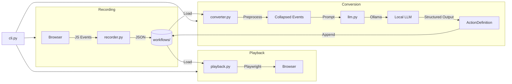

# Architecture

Technical overview of browser-agents - a tool for recording browser interactions and converting them to reusable automation definitions.

## System Overview



## Components

### Entry Point: `cli.py`

Typer-based CLI with five commands:
- `record <url>` - Start recording session (supports `--name`, `--description`)
- `replay <file>` - Replay a recording (supports `--guided`, `--name` for action selection)
- `convert <file>` - Convert to ActionDefinition via LLM (appends to actions list)
- `list [dir]` - List all workflows with their names and actions
- `set-success <file>` - Define success criteria for a workflow

Uses lazy imports for heavy dependencies (LangChain loaded only for `convert`).

### Recording: `recorder.py`

Captures browser events via injected JavaScript:
1. Injects `RECORDER_SCRIPT` into pages via `page.add_init_script()`
2. Exposes `__recordEvent` callback via `page.expose_function()`
3. JavaScript listeners capture: clicks, input, scroll
4. Playwright's `framenavigated` event captures navigation
5. Saves to unified Workflow JSON format

**Key patterns**:
- Uses injected JS instead of CDP for reliability across sites
- Browser close detection via page "close" event (stops recording when user closes window)
- Ctrl+C handler also works as fallback

### Playback: `playback.py`

Replays workflows with Playwright:
- Loads events via Pydantic validation
- Executes each event type (navigate, click, type, scroll, wait)
- Fallback: coordinates when selector fails
- Demo mode: visual cursor via `demo.py`
- Guided mode: interactive error handling with LLM diagnosis

**Guided Replay Mode** (`--guided`):

When a step fails, guided mode pauses and provides:
1. LLM-based error diagnosis via `_diagnose_error_with_llm()`
2. Error classification (conversion, execution, verification)
3. Context-aware action menu based on error type
4. Re-record option to fix incorrect steps in-place
5. Describe fix option (`[f]`) for natural language problem description
6. Go back option (`[b]`) to rewind and fix an earlier step

Error types and typical actions:
- **CONVERSION**: LLM generated wrong step - Delete, Re-record, Skip, Describe fix, Go back
- **EXECUTION**: Step failed to run (timeout, not found) - Retry, Re-record, Manual fix, Describe fix, Go back
- **VERIFICATION**: Step ran but wrong result - Continue, Retry, Manual fix, Describe fix, Go back

**Look-Ahead Warning System**:

After each successful step, guided mode checks if the next step's target element exists on the page via `_check_next_step_ready()`. If the element is missing, a warning is recorded and displayed as "[Next step issue]" in the step history. This helps identify when an earlier step navigated to the wrong page.

**Step History Tracking**:

The `StepHistory` dataclass tracks execution state:
- `status`: PENDING, OK, WARN (step OK but next step has issue), FAIL
- `warning`: Optional message about detected issues
- `warning_about_next`: True if warning predicts next step will fail

`_show_step_history()` displays progress with status indicators (OK, WARN, FAIL).

**Go-Back Flow**:

When user selects go-back:
1. Shows warned steps with their target step index (look-ahead warnings map to next step)
2. User chooses which step to retry
3. Navigates back to start URL and waits for page load (`networkidle`)
4. Replays all steps up to the target with brief pauses (0.3s) between steps
5. Resets history for target step onwards
6. Continues from target step

**Abort Handling**:

When replay is aborted (including during rewind):
- Modifications summary notes this was a partial run
- Save prompt defaults to NOT saving changes (vs. default=True for complete runs)

**Describe Fix Flow**:

When user selects `[f]` (describe fix), the system:
1. Prompts user to describe the problem in natural language
2. Sends step context + error + user feedback to LLM
3. LLM returns `StepFixSuggestion` with `fix_type`: delete, modify, or keep
4. System applies the suggested fix or retries as appropriate

### Conversion: `converter.py`

Transforms raw recordings to ActionDefinitions:
1. `load_recording()` - Parse JSONL to Recording model
2. `preprocess_events()` - Collapse keystrokes, remove scrolls, dedupe navigations
3. Load prompt from `prompts/convert_recording.yaml`
4. Call LLM with structured output (Pydantic schema)
5. Validate and return ActionDefinition

**Key pattern**: Preprocessing reduces 100+ keystroke events to ~10 logical steps.

### LLM: `llm.py`

Factory for LLM clients with multi-provider support:
- `get_structured_llm(schema)` enforces Pydantic output via `with_structured_output()`
- Provider selected via `LLM_PROVIDER` environment variable

**Supported Providers:**

| Provider | Client | Configuration |
|----------|--------|---------------|
| Ollama (default) | `ChatOpenAI` with `base_url` | Points to Ollama's `/v1` endpoint (OpenAI-compatible) |
| Anthropic | `ChatAnthropic` | Dedicated client required (ChatOpenAI incompatible) |
| OpenAI | `ChatOpenAI` | Native client |

**Why different clients?**
- Ollama exposes an OpenAI-compatible `/v1` endpoint, so `ChatOpenAI` works
- Anthropic's API differs from OpenAI's, requiring `langchain-anthropic`
- Native `ChatOllama` has tool calling bugs, so we use `ChatOpenAI` instead

### Configuration: `config.py`

Pydantic-settings singleton supporting `.env` files.

## Data Flow

### Recording Flow

```
User interacts with Browser
         ↓
Injected JS listener captures event
         ↓
window.__recordEvent(data) callback
         ↓
BrowserRecorder._handle_page_event()
         ↓
RecordedEvent Pydantic model created
         ↓
Appended to in-memory list
         ↓ (browser close or Ctrl+C)
save_workflow() writes JSON
```

### Conversion Flow

```
Workflow JSON file
    ↓
load_workflow() → Workflow model
    ↓
preprocess_events() → simplified event list
    ↓
Format with YAML prompt template
    ↓
get_structured_llm(ActionDefinition)
    ↓
LLM generates structured output
    ↓
Append to workflow.actions list
    ↓
save_workflow() updates JSON file
```

### Error Diagnosis Flow (Guided Replay)

```
Step execution fails
         ↓
_diagnose_error_with_llm(step, error)
         ↓
Load prompts/diagnose_error.yaml
         ↓
get_structured_llm(ErrorDiagnosis)
         ↓
LLM returns: error_type, explanation, suggestion, likely_cause
         ↓ (fallback if LLM unavailable)
_classify_error() + _get_plain_language_error()
         ↓
_prompt_user_guidance() shows context-aware menu
         ↓
User chooses action (retry, skip, delete, re-record, etc.)
```

**Key pattern**: LLM diagnosis with pattern-matching fallback ensures the feature works offline.

## Key Design Decisions

| Decision | Choice | Reason |
|----------|--------|--------|
| Event capture | Injected JS | CDP unreliable across sites (CSP, frames) |
| LLM providers | Multi-provider | Ollama (local), Anthropic, OpenAI via `LLM_PROVIDER` |
| Ollama client | `ChatOpenAI` | Native `ChatOllama` has tool call bugs |
| Storage format | Unified JSON | Single file with events + actions + metadata |
| LLM input | Preprocessed | Raw recordings too verbose (100+ events) |
| LLM output | Structured | Pydantic validation guaranteed |
| Error handling | Return strings | Simpler async control flow |
| Multiple actions | Append to list | Same recording can have different interpretations |

## Validation Boundaries

Pydantic validation happens at system boundaries:

| Boundary | Model |
|----------|-------|
| Event creation | `RecordedEvent` |
| File loading | `Workflow.model_validate_json()` |
| LLM conversion output | `ActionDefinition` (structured output) |
| LLM diagnosis output | `ErrorDiagnosis` (structured output) |
| LLM fix suggestion | `StepFixSuggestion` (structured output) |
| Config loading | `Settings` |

## Storage Layout

```
workflows/
  {session_id}/
    workflow.json          # Unified Workflow (events + actions + metadata)
    screenshots/           # Screenshots from recording
      0001.png
      0002.png
```

### Workflow Format (v2)

The `Workflow` model is the single source of truth for a browser automation:

```json
{
  "id": "abc123",
  "version": 2,
  "name": "Login Flow",
  "description": "Log into the application",
  "source_url": "https://example.com",
  "created_at": "2024-12-21T10:00:00Z",
  "events": [
    {"timestamp": 1.0, "event_type": "navigate", "url": "..."},
    {"timestamp": 2.0, "event_type": "click", "selector": "#btn", "x": 100, "y": 200},
    {"timestamp": 3.0, "event_type": "type", "selector": "#input", "value": "text"}
  ],
  "actions": [
    {
      "name": "login_user",
      "description": "Log in with credentials",
      "parameters": [{"name": "email", "description": "...", "example": "..."}],
      "steps": [{"action": "type", "target": "#email", "value": "{email}"}],
      "domains": ["example.com"]
    }
  ],
  "media": null,
  "success_condition": null
}
```

**Key fields:**
- `version`: Schema version (currently 2) for future migrations
- `name`: Human-readable workflow name (optional, set via `--name` flag)
- `description`: What the workflow does (optional, set via `--description` flag)
- `events`: Raw recorded browser events (always present after recording)
- `actions`: List of LLM-derived action definitions (multiple allowed, added by `convert`)

**Multiple actions per workflow:**
- Same recording can have multiple action interpretations
- Each `convert` call appends a new action to the list
- User selects which action to replay via `--name` flag
- If multiple actions and no name specified, user is prompted to choose

**Legacy support:** Workflows with singular `action` field are auto-converted to `actions` list on load.
