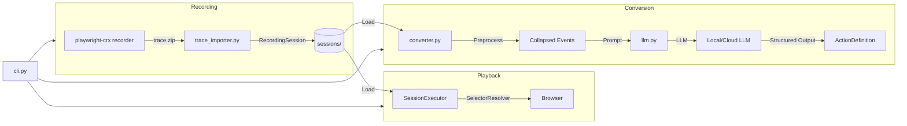

# Architecture

Technical overview of browser-agents - a tool for recording browser interactions and converting them to reusable automation definitions.

## System Overview



## Components

### Entry Point: `cli.py`

Typer-based CLI with session commands:

- `launch-chrome` - Launch Chrome with debugging port
- `record` - Connect to Chrome via CDP, trace, wait for Enter, auto-import
- `import-trace <file>` - Import existing trace.zip
- `replay-session <session>` - Replay session (supports `--safe`, `--trace`)
- `convert-session <session>` - Convert session to ActionDefinition via LLM
- `list-sessions` - List all sessions

Uses lazy imports for heavy dependencies (LangChain loaded only for `convert-session`).

### Recorder: `recorder/`

Playwright-crx based Chrome extension for recording:

Built on playwright-crx, which provides Playwright's recording capabilities as a Chrome extension. Records to trace.zip format containing action events, network traffic, screenshots, and DOM snapshots.

**Build once:**
```bash
cd recorder && npm install && npm run build
```

**Load in Chrome:**
Load `recorder/extension/dist/` as unpacked extension.

### Importers Package: `importers/`

| Module | Purpose |
|--------|---------|
| `trace_importer.py` | Import playwright-crx trace.zip → RecordingSession |

**parse_playwright_selector()** - Converts Playwright internal selectors:
- `internal:role=button[name="Submit"]` → role selector
- `internal:label="Email"` → label selector
- `internal:text="Click"` → text selector
- CSS selectors → css selector

### Models Package: `models/`

Pydantic models for recording sessions:

| Module | Models |
|--------|--------|
| `events.py` | `UIEvent`, `UIEventType` (11 event types) |
| `network.py` | `NetworkRequest` (captured HTTP traffic) |
| `session.py` | `RecordingSession`, `SessionMetadata`, `VideoInfo` |
| `workflow.py` | `ActionDefinition`, `ActionStep`, `ActionParameter` |

**UIEventType** - 11 event types:
- Mouse: `click`, `double_click`, `right_click`
- Input: `type`, `clear`, `select_option`
- Checkbox: `check`, `uncheck`
- Other: `scroll`, `navigate`, `key_press`

### Playback Package: `playback/`

Session replay:

| Module | Class | Purpose |
|--------|-------|---------|
| `executor.py` | `SessionExecutor` | Handles all 11 event types |
| `safe_replay.py` | `SafeReplayController` | Network interception |

**SafeReplayMode** - Network interception modes:
- `LIVE` - No interception
- `WARN` - Log but allow POST/PUT/DELETE
- `BLOCK` - Abort state-changing requests
- `MOCK` - Return fake success responses

### Storage Package: `storage/`

| Module | Class | Purpose |
|--------|-------|---------|
| `session_store.py` | `SessionStore` | Load/save sessions to `sessions/` |

### Conversion: `converter.py`

Transforms session recordings to ActionDefinitions:
1. Load session from `sessions/` directory
2. `preprocess_events()` - Collapse keystrokes, remove scrolls, dedupe navigations
3. Load prompt from `prompts/convert_session.yaml`
4. Call LLM with structured output (Pydantic schema)
5. Validate and return ActionDefinition

**Key pattern**: Preprocessing reduces 100+ keystroke events to ~10 logical steps.

### LLM: `llm.py`

Factory for LLM clients with multi-provider support:
- `get_structured_llm(schema)` enforces Pydantic output via `with_structured_output()`
- Provider selected via `LLM_PROVIDER` environment variable

**Supported Providers:**

| Provider | Client | Configuration |
|----------|--------|---------------|
| Ollama (default) | `ChatOpenAI` with `base_url` | Points to Ollama's `/v1` endpoint (OpenAI-compatible) |
| Anthropic | `ChatAnthropic` | Dedicated client required (ChatOpenAI incompatible) |
| OpenAI | `ChatOpenAI` | Native client |

**Why different clients?**
- Ollama exposes an OpenAI-compatible `/v1` endpoint, so `ChatOpenAI` works
- Anthropic's API differs from OpenAI's, requiring `langchain-anthropic`
- Native `ChatOllama` has tool calling bugs, so we use `ChatOpenAI` instead

### Configuration: `config.py`

Pydantic-settings singleton supporting `.env` files.

## Data Flow

### Recording Flow (playwright-crx)

```
User interacts with Browser
         ↓
playwright-crx captures events
         ↓
Exports trace.zip (NDJSON + resources)
         ↓
trace_importer.py parses trace.trace
         ↓
Converts Playwright selectors → SelectorCandidate
         ↓
RecordingSession saved to sessions/
```

### Conversion Flow

```
Session JSON file (sessions/)
    ↓
SessionStore.load() → RecordingSession model
    ↓
preprocess_events() → simplified event list
    ↓
Format with YAML prompt template
    ↓
get_structured_llm(ActionDefinition)
    ↓
LLM generates structured output
    ↓
Save to sessions/{id}/processed/workflow.json
```

## Key Design Decisions

| Decision | Choice | Reason |
|----------|--------|--------|
| Recording method | playwright-crx extension | Playwright's reliability + Chrome extension convenience |
| Import format | trace.zip (NDJSON) | Rich action data + screenshots + DOM snapshots |
| Multi-selector | 6 strategies per event | Resilient replay (fallback if one selector breaks) |
| LLM providers | Multi-provider | Ollama (local), Anthropic, OpenAI via `LLM_PROVIDER` |
| Storage format | Session JSON | Events + multi-selector candidates + metadata |
| LLM input | Preprocessed | Raw recordings too verbose (100+ events) |
| LLM output | Structured | Pydantic validation guaranteed |
| Error handling | Return strings | Simpler async control flow |

## Validation Boundaries

Pydantic validation happens at system boundaries:

| Boundary | Model |
|----------|-------|
| Event creation | `UIEvent` |
| Session loading | `RecordingSession.model_validate_json()` |
| LLM conversion output | `ActionDefinition` (structured output) |
| Config loading | `Settings` |

## Storage Layout

```
sessions/
  {session_id}/
    session.json           # RecordingSession (UIEvents + NetworkRequests)
    trace.zip              # Original recording trace
    replay_trace.zip       # Playwright trace from replay (if --trace used)
    processed/
      workflow.json        # ActionDefinition from LLM conversion
```

### Session Format (RecordingSession)

Imported trace.zip files convert to `RecordingSession`:

```json
{
  "metadata": {
    "id": "sess_abc123",
    "source_url": "https://example.com",
    "started_at": "2024-12-21T10:00:00Z"
  },
  "events": [
    {
      "timestamp": "2024-12-21T10:00:01Z",
      "event_type": "click",
      "selector": "role=button[name=\"Submit\"]",
      "x": 100,
      "y": 200
    }
  ],
  "network_requests": [
    {
      "timestamp": "2024-12-21T10:00:02Z",
      "method": "GET",
      "url": "https://example.com/api/data",
      "status": 200,
      "duration_ms": 45.2
    }
  ]
}
```
