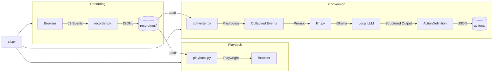

# Architecture

Technical overview of browser-agents - a tool for recording browser interactions and converting them to reusable automation definitions.

## System Overview



## Components

### Entry Point: `cli.py`

Typer-based CLI with three commands:
- `record <url>` - Start recording session
- `replay <file>` - Replay a recording
- `convert <file>` - Convert to ActionDefinition via LLM

Uses lazy imports for heavy dependencies (LangChain loaded only for `convert`).

### Recording: `recorder.py`

Captures browser events via injected JavaScript:
1. Injects `RECORDER_SCRIPT` into pages via `page.add_init_script()`
2. Exposes `__recordEvent` callback via `page.expose_function()`
3. JavaScript listeners capture: clicks, input, scroll
4. Playwright's `framenavigated` event captures navigation
5. Saves to JSONL (metadata line + event lines)

**Key pattern**: Uses injected JS instead of CDP for reliability across sites.

### Playback: `playback.py`

Replays JSONL recordings with Playwright:
- Loads events via Pydantic validation
- Executes each event type (navigate, click, type, scroll, wait)
- Fallback: coordinates when selector fails
- Demo mode: visual cursor via `demo.py`

### Conversion: `converter.py`

Transforms raw recordings to ActionDefinitions:
1. `load_recording()` - Parse JSONL to Recording model
2. `preprocess_events()` - Collapse keystrokes, remove scrolls, dedupe navigations
3. Load prompt from `prompts/convert_recording.yaml`
4. Call LLM with structured output (Pydantic schema)
5. Validate and return ActionDefinition

**Key pattern**: Preprocessing reduces 100+ keystroke events to ~10 logical steps.

### LLM: `llm.py`

Factory for local Ollama models:
- Uses `ChatOpenAI` pointed at Ollama's `/v1` endpoint
- Better tool calling than native `ChatOllama`
- `get_structured_llm(schema)` enforces Pydantic output

### Configuration: `config.py`

Pydantic-settings singleton supporting `.env` files.

## Data Flow

### Recording Flow

```
User interacts with Browser
         ↓
Injected JS listener captures event
         ↓
window.__recordEvent(data) callback
         ↓
BrowserRecorder._handle_page_event()
         ↓
RecordedEvent Pydantic model created
         ↓
Appended to in-memory list
         ↓ (Ctrl+C)
_save_recording() writes JSONL
```

### Conversion Flow

```
JSONL file
    ↓
load_recording() → Recording model
    ↓
preprocess_events() → simplified event list
    ↓
Format with YAML prompt template
    ↓
get_structured_llm(ActionDefinition)
    ↓
LLM generates structured output
    ↓
Save as JSON file
```

## Key Design Decisions

| Decision | Choice | Reason |
|----------|--------|--------|
| Event capture | Injected JS | CDP unreliable across sites (CSP, frames) |
| Ollama client | `ChatOpenAI` | Native `ChatOllama` has tool call bugs |
| Storage format | JSONL | Append-only, streamable, human-readable |
| LLM input | Preprocessed | Raw recordings too verbose (100+ events) |
| LLM output | Structured | Pydantic validation guaranteed |
| Error handling | Return strings | Simpler async control flow |

## Validation Boundaries

Pydantic validation happens at system boundaries:

| Boundary | Model |
|----------|-------|
| Event creation | `RecordedEvent` |
| File loading | `RecordedEvent.model_validate_json()` |
| LLM output | `ActionDefinition` (structured output) |
| Config loading | `Settings` |

## Storage Layout

```
recordings/
  {session_id}.jsonl       # Raw recordings

actions/
  {action_name}.json       # Converted ActionDefinitions
```

### JSONL Format

```json
{"session_id": "abc123", "start_url": "https://...", "started_at": "..."}
{"timestamp": 1.0, "event_type": "navigate", "url": "..."}
{"timestamp": 2.0, "event_type": "click", "selector": "#btn", "x": 100, "y": 200}
{"timestamp": 3.0, "event_type": "type", "selector": "#input", "value": "text"}
```

### ActionDefinition Format

```json
{
  "name": "login_user",
  "description": "Log in with credentials",
  "parameters": [{"name": "email", "description": "...", "example": "..."}],
  "steps": [{"action": "type", "target": "#email", "value": "{email}"}],
  "domains": ["example.com"]
}
```
