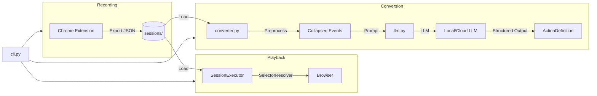

# Architecture

Technical overview of browser-agents - a tool for recording browser interactions and converting them to reusable automation definitions.

## System Overview



## Components

### Entry Point: `cli.py`

Typer-based CLI with session commands:

- `import-session <file>` - Import Chrome extension export
- `replay-session <session>` - Replay with multi-selector resolution (supports `--safe`)
- `convert-session <session>` - Convert session to ActionDefinition via LLM
- `list-sessions` - List all sessions

Uses lazy imports for heavy dependencies (LangChain loaded only for `convert-session`).

### Chrome Extension: `browser-recorder-extension/`

MV3 Chrome extension for recording from existing browser session:

| File | Purpose |
|------|---------|
| `manifest.json` | MV3 config, `all_frames: true` for iframe support |
| `background.js` | Service worker, session state, navigate events |
| `content.js` | Event capture (11 event types) |
| `selector-generator.js` | Codegen-style selectors |
| `popup.html/js` | Start/stop/export UI |

**Advantages over Playwright:**
- User's existing session (logged in, cookies)
- iframe capture via `all_frames: true`
- No browser launch overhead

### Models Package: `models/`

New Pydantic models for Codegen-style multi-selector capture:

| Module | Models |
|--------|--------|
| `selectors.py` | `SelectorCandidate` (strategy, value, confidence) |
| `events.py` | `UIEvent`, `UIEventType` (11 event types) |
| `session.py` | `RecordingSession`, `SessionMetadata`, `VideoInfo` |
| `workflow.py` | `ActionDefinition`, `ActionStep`, `ActionParameter` |

**SelectorCandidate strategies** (priority order):
1. `role` - ARIA role + accessible name (highest priority)
2. `label` - Form label text
3. `placeholder` - Input placeholder
4. `text` - Element text content
5. `testid` - data-testid attribute
6. `css` - CSS selector (fallback)

**UIEventType** - 11 event types:
- Mouse: `click`, `double_click`, `right_click`
- Input: `type`, `clear`, `select_option`
- Checkbox: `check`, `uncheck`
- Other: `scroll`, `navigate`, `key_press`

### Playback Package: `playback/`

Session replay with multi-selector resolution:

| Module | Class | Purpose |
|--------|-------|---------|
| `selector_resolver.py` | `SelectorResolver` | Priority-based selector resolution |
| `executor.py` | `SessionExecutor` | Handles all 11 event types |
| `safe_replay.py` | `SafeReplayController` | Network interception |

**SelectorResolver** - Tries selectors in priority order:
```python
async def resolve(self, event: UIEvent) -> Locator | None:
    for candidate in event.selectors:
        locator = self._to_locator(candidate)
        if await locator.count() == 1:
            return locator
    return None  # Fall back to coordinates
```

**SafeReplayMode** - Network interception modes:
- `LIVE` - No interception
- `WARN` - Log but allow POST/PUT/DELETE
- `BLOCK` - Abort state-changing requests
- `MOCK` - Return fake success responses

### Storage Package: `storage/`

| Module | Class | Purpose |
|--------|-------|---------|
| `session_store.py` | `SessionStore` | Load/save sessions to `sessions/` |

### Conversion: `converter.py`

Transforms session recordings to ActionDefinitions:
1. Load session from `sessions/` directory
2. `preprocess_events()` - Collapse keystrokes, remove scrolls, dedupe navigations
3. Load prompt from `prompts/convert_session.yaml`
4. Call LLM with structured output (Pydantic schema)
5. Validate and return ActionDefinition

**Key pattern**: Preprocessing reduces 100+ keystroke events to ~10 logical steps.

### LLM: `llm.py`

Factory for LLM clients with multi-provider support:
- `get_structured_llm(schema)` enforces Pydantic output via `with_structured_output()`
- Provider selected via `LLM_PROVIDER` environment variable

**Supported Providers:**

| Provider | Client | Configuration |
|----------|--------|---------------|
| Ollama (default) | `ChatOpenAI` with `base_url` | Points to Ollama's `/v1` endpoint (OpenAI-compatible) |
| Anthropic | `ChatAnthropic` | Dedicated client required (ChatOpenAI incompatible) |
| OpenAI | `ChatOpenAI` | Native client |

**Why different clients?**
- Ollama exposes an OpenAI-compatible `/v1` endpoint, so `ChatOpenAI` works
- Anthropic's API differs from OpenAI's, requiring `langchain-anthropic`
- Native `ChatOllama` has tool calling bugs, so we use `ChatOpenAI` instead

### Configuration: `config.py`

Pydantic-settings singleton supporting `.env` files.

## Data Flow

### Recording Flow (Chrome Extension)

```
User interacts with Browser
         ↓
Chrome Extension content.js captures event
         ↓
selector-generator.js creates multi-selector candidates
         ↓
UIEvent model created with selectors
         ↓
Accumulated in extension state
         ↓ (user clicks "Export Session")
JSON file exported for import
```

### Conversion Flow

```
Session JSON file (sessions/)
    ↓
SessionStore.load() → RecordingSession model
    ↓
preprocess_events() → simplified event list
    ↓
Format with YAML prompt template
    ↓
get_structured_llm(ActionDefinition)
    ↓
LLM generates structured output
    ↓
Save to sessions/{id}/processed/workflow.json
```

## Key Design Decisions

| Decision | Choice | Reason |
|----------|--------|--------|
| Recording method | Chrome Extension | User's existing session (logged in, cookies, iframes) |
| Multi-selector | 6 strategies per event | Resilient replay (fallback if one selector breaks) |
| LLM providers | Multi-provider | Ollama (local), Anthropic, OpenAI via `LLM_PROVIDER` |
| Storage format | Session JSON | Events + multi-selector candidates + metadata |
| LLM input | Preprocessed | Raw recordings too verbose (100+ events) |
| LLM output | Structured | Pydantic validation guaranteed |
| Error handling | Return strings | Simpler async control flow |

## Validation Boundaries

Pydantic validation happens at system boundaries:

| Boundary | Model |
|----------|-------|
| Event creation | `UIEvent` |
| Session loading | `RecordingSession.model_validate_json()` |
| LLM conversion output | `ActionDefinition` (structured output) |
| Config loading | `Settings` |

## Storage Layout

```
sessions/
  {session_id}/
    session.json           # RecordingSession (UIEvents with multi-selector)
    media/
      recording.webm       # Video (optional, future)
    processed/
      workflow.json        # ActionDefinition from LLM conversion
```

### Session Format (RecordingSession)

Chrome extension exports use `RecordingSession` with multi-selector `UIEvent`:

```json
{
  "metadata": {
    "session_id": "sess_abc123",
    "source_url": "https://example.com",
    "created_at": "2024-12-21T10:00:00Z"
  },
  "events": [
    {
      "timestamp": "2024-12-21T10:00:01Z",
      "event_type": "click",
      "selectors": [
        {"strategy": "role", "value": "button", "confidence": "high", "role": "button", "name": "Submit"},
        {"strategy": "testid", "value": "submit-btn", "confidence": "high"},
        {"strategy": "css", "value": "#submit-button", "confidence": "low"}
      ],
      "x": 100,
      "y": 200,
      "element_type": "button",
      "element_text": "Submit"
    }
  ]
}
```
